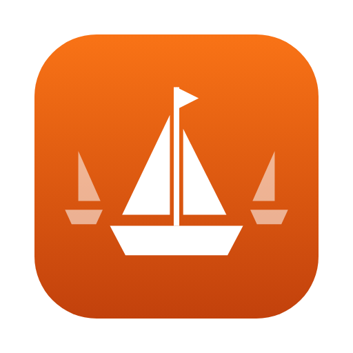

<p align="center">
  
</p>

<h1 align="center">flotilla</h1>

<p align="center">
  <a href="https://github.com/Lockyc/flotilla/releases/latest"></a>
  
  
  <a href="LICENSE"></a>
</p>

A macOS workspace for work that spreads across many documents. Each piece of work is a **group**: a head tab (usually a Google Drive folder) with the documents opened from it listed beneath. Every document is open in exactly one place, so you stop losing track of which folder is open and which docs already are.

**Status:** early (0.x). Google Docs, Sheets, Slides, Forms and Drive files are recognised as documents; other sites open as ordinary tabs.

## How it works

- **Groups form as you work.** Paste a folder or page link into the field at the top of the sidebar (**⌘N**) to open it as a group. Any tab can head a group. A link to a document, clicked in any tab of a group, opens as a member of that group, with no setup. Every group and document is kept in the [config](#config), where it can also be edited by hand.
- **Windows.** Each window holds its own groups. **Window ▸ New Window…** (**⌥⌘N**) adds one; right-click a window's title row to rename, recolour or delete it. A closed window stays in the **Window** menu and reopens as it was.
- **Each document is open once.** Opening a document that is already open, in any group, window or popped-out window, brings up the existing tab (and its window) instead of a second copy.
- **Pop out.** Any tab can move into its own window (**⌘⇧O**); closing that window (**⌘W**) puts the tab back in its group. A document opened from a popped-out window joins its group in the window it came from, which comes to the front.
- **Back and forward.** The buttons above the sidebar step the active tab through its history, and Home returns it to the page it opened with. A mouse's back and forward buttons work in every window, popped-out ones included.
- **Restored on relaunch.** Every group comes back with its head, its documents and its popped-out windows, and the tabs that were loaded load again.
- **Unload, remove and reopen.** **⌘W** unloads the active tab, keeping its row; the live dot unloads any row. A row's bin removes the tab, and **⌘⇧⌫** closes its whole group, popped-out windows included. A closed group (or a removed head, which takes its group with it) is kept: choosing it under **Group ▸ Recent** reopens it with its documents, docked in the focused window; **Recent ▸ Clear Recent** empties the list.
- **Find things in the sidebar.** Groups list their documents beneath them, each marked as a Doc, Sheet, Slides deck, Form or Drive folder, and search covers every group. Right-click a row, or use the **Group** menu, for Home, Rename…, Set Home to Current Page, Make Own Group, Move to Group, Remove Tab and Close Group.
- **Links sent from other apps.** `open -a flotilla <link>`, or a link router, hands flotilla a link, and the last focused window takes it. A folder or page opens as a new group, and a document already open is brought up. Any other document waits under **Incoming** at the top of the sidebar until you **Add to** the active group, **Add to group…**, open it as a **New group**, or **Dismiss** it. A link aimed at a window and group ([below](#for-link-routers)) joins that group directly. The queue is kept across relaunches.
- **Names and homes are yours.** A new group or document is named by its page's title once it loads; after that the name stays as written, wherever the tab navigates. **Rename…** edits it in place. **Set Home to Current Page** makes the page a tab has browsed to its home, so Home and relaunch land there; a group keeps its documents.

Links to other sites leave flotilla for your default browser. Content runs in WKWebView (Safari's engine), so Chrome extensions and Docs offline mode are not available.

## Install

Download `flotilla-<version>-macos.zip` from the [latest release](https://github.com/Lockyc/flotilla/releases/latest), unzip, and move `flotilla.app` to `/Applications`. macOS only.

In **Claude Code**, run `/flotilla:install` — it checks prerequisites (offering to install any that are missing), builds flotilla from source into `~/.flotilla` and installs `flotilla.app` to `/Applications`. Without Claude Code (needs Rust and Xcode Command Line Tools):

```sh
curl -fsSL https://raw.githubusercontent.com/Lockyc/flotilla/main/install.sh | bash
```

## Updates

flotilla updates itself. On launch, every 6 hours while open, and via **flotilla ▸ Check for Updates…**, it checks GitHub for a newer release; when one exists the sidebar shows an *Update available* bar with a one-click **Update & Relaunch**. Nothing installs without your approval, and each update's signature is verified first.

## Config

The config is `~/.config/flotilla/config.toml` (or the file `FLOTILLA_CONFIG` names): app-wide settings, then your windows with their groups and documents. **Config ▸ Edit Config** opens it, writing a starter file first if there is none. Saving hot-reloads; a file that doesn't parse keeps the last good config and shows the error in the sidebar.

```toml
[[window]]
  title  = "Club"
  colour = "#2a6f4e"
  [[window.group]]
    name = "Club drive"
    url  = "https://drive.google.com/drive/folders/0AbCdEfGhIjKlMnOpQ"
    [[window.group.tab]]
      title = "Club – Budget"
      url   = "https://docs.google.com/spreadsheets/d/1AbCdEfGhIjKlMnOpQrSt04/edit"
```

A document is open once across every window: two heads or tabs naming the same document in the same `store` are a config error.

| Key | Default | What it does |
|---|---|---|
| `[[window]]` `title` | required | The window's name, shown in the sidebar banner, the window title and **Window** menu. Unique. |
| `[[window]]` `colour` | none | `#rgb` / `#rrggbb` accent for the sidebar, the **Window** menu swatch and popped-out windows. |
| `[[window]]` `width`, `height` | `1500`, `1000` | The window's size on its first open. |
| `[[window]]` `open_on_start` | `true` | `false` leaves the window closed at launch until opened from the **Window** menu. |
| `[[window]]` `open_tabs_section` | inherited from global | Whether this window's sidebar pins the **Open** section. |
| `[[window.group]]` `name` | required | The group's name in the sidebar. Unique within its window. A new group is written named by its URL, then by its page's title once that loads; after that the name stays as written. |
| `[[window.group]]` `url` | required | The group's head and Home: a Drive folder or a document. |
| `[[window.group]]` `store` | `"default"` | The login store the group's documents open in; another store is another account. |
| `[[window.group]]` `collapsed` | `false` | Shows the head alone. |
| `[[window.group]]` `detached` | `false` | The head is popped out; reopens in its own window. |
| `[[window.group.tab]]` `title` | required | The document's name in the sidebar, written like a group's `name`. |
| `[[window.group.tab]]` `url` | required | The document, and its Home. |
| `[[window.group.tab]]` `detached` | `false` | Popped out; reopens in its own window. |
| `density` | `"comfortable"` | Chrome sizing: `comfortable` or `compact` (type and spacing scaled down). Hot-reloads. |
| `dark_mode` | `false` | Force a dark appearance so pages honouring `prefers-color-scheme` render dark. Hot-reloads. |
| `tab_digit_keys` | `"jump"` | What ⌘1/⌘2 do: `jump` — ⌘1–⌘9 go to that tab; `cycle` — ⌘1 next tab, ⌘2 previous, ⌘3–⌘9 go to that tab. **Tab ▸ Cycle Tabs with ⌘1/⌘2** flips it. Hot-reloads. |
| `auto_update` | `true` | Check for a new release on launch and every 6 hours. `false` stops the automatic checks; **Check for Updates…** still works. Read as each window opens. |
| `allow_insecure` | `[]` | Hosts whose self-signed or invalid TLS certificate is accepted. Read at launch (restart to change). |
| `open_tabs_section` | `false` | Pin an **Open** section above the groups, listing every document that is loaded or popped out under its group, which collapses there as it does below. Each keeps its row in its group too, so the list never shuffles; ⌘1–⌘9 and tab cycling ignore the section. It grows to 2/5 of the window, then scrolls on its own; its header collapses it. A window's own `open_tabs_section` overrides it. Hot-reloads. |
| `format_on_save` | `false` | Reformat the config in house style on each clean reload. A file that fails to parse is left untouched. |

## For link routers

flotilla takes `flotilla://open?window=<title>&group=<name>&url=<link>`, every value percent-encoded. `window` names the window to take the link (else the last focused one), and `group` the group in it a document joins (else it waits under Incoming). Launch it with `open -b au.lsjc.flotilla '<that URL>'`.

The windows and their groups are published in `~/Library/Application Support/au.lsjc.flotilla/windows.json`, written at launch and whenever they change. Windows are in config order and groups in sidebar order; `colour` is `null` for a window without one:

```json
{"version":1,"windows":[{"title":"Rotary","colour":"#17458f","groups":["Rotary (interim)","Bulletins"]}]}
```

## Build

```sh
just run      # run the app
just gate     # format check, clippy, tests
just build    # release .app bundle
```

## License

MIT — see [LICENSE](LICENSE).
