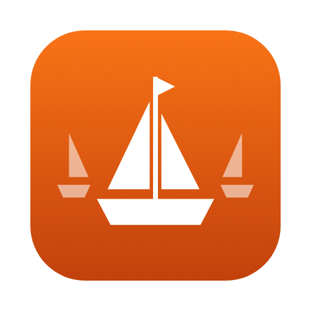

# flotilla

[](https://github.com/lockyc/flotilla/releases/latest)


[](LICENSE)

A macOS workspace for work that spreads across many documents. Each piece of work is a
**group**: a head tab, usually a Google Drive folder, with the documents opened from it listed
beneath. Every document is open in exactly one place, so you stop losing track of which folder is
open and which docs already are.

## Install

**Download:** grab `flotilla-<version>-macos.zip` from the
[latest release](https://github.com/lockyc/flotilla/releases/latest), unzip, and move
`flotilla.app` to `/Applications`. Releases are signed and notarized.

**Or build from source** into `~/.flotilla` (needs Rust and the Xcode Command Line Tools):

```sh
curl -fsSL https://raw.githubusercontent.com/lockyc/flotilla/main/install.sh | bash
```

flotilla updates itself: on launch, every 6 hours, and from **flotilla ▸ Check for Updates…**, an
*Update available* bar offers **Update & Relaunch**. Nothing installs without your approval, and
each update's signature is checked first.

## First run

Paste a Drive folder or document link into the field at the top of the sidebar (**⌘N**): it opens
as a group. Sign in to Google in that tab. Documents you open from it join the group.

## Features

- **Groups form as you work.** Any tab can head a group, and a document link clicked in any tab of
  a group opens as a member of that group, with no setup. Every group and document is kept in the
  [config](#configuration), where it can also be edited by hand.
- **Each document is open once.** Opening a document that is already open, in any group or
  window, brings up the existing tab instead of a second copy.
- **Windows.** Each window holds its own groups. **Window ▸ New Window…** (**⌥⌘N**) adds one;
  right-click a window's title row to rename, recolour or delete it. A closed window stays in the
  **Window** menu and reopens as it was.
- **Pop out** any tab into its own window (**⌘⇧O**); closing that window (**⌘W**) puts the tab
  back in its group.
- **The sidebar** marks each document as a Doc, Sheet, Slides deck, Form or Drive folder, and
  search covers every group. Right-click a row, or use the **Group** menu, to rename, move,
  re-home or remove it; drag a document onto another group to move it there. Collapse the
  sidebar (**⌃⌘S**) and rest the pointer on the window's left edge to slide it back in.
- **Unload and reopen.** **⌘W** unloads the active tab and keeps its row; **Unload Group** unloads
  a whole group and **Group ▸ Unload All** every tab in the window. **⌘⇧⌫** closes a group, and **Group ▸ Recent** reopens it with its documents.
- **Restored on relaunch** — every group comes back with its head, its documents and its
  popped-out windows, and the tabs that were loaded load again.
- **Downloads** — **File ▸ Download** in a Doc, Sheet or Slides deck saves to `~/Downloads`, and
  the downloads button beside the link field lists recent ones.
- **Links from other apps.** `open -a flotilla <link>`, or a link router, hands flotilla a link. A
  folder or page opens as a new group and a document already open is brought up. Any other
  document opens under **Unsorted**, then moves into the group whose Drive folder holds it once
  Google says where it lives — which needs **Group ▸ Connect Google Account…**: it signs in
  through your browser and can see your Drive files' details, never their contents. A link that
  can't open waits under **Incoming** until you place or dismiss it.
- **Names and homes are yours.** A new group or document is named by its page's title once it
  loads; after that the name stays as written. **Set Home to Current Page** makes the page a tab
  has browsed to its home.

## Configuration

`~/.config/flotilla/config.toml` (or the file `FLOTILLA_CONFIG` names). **Config ▸ Edit Config**
opens it, writing a starter file first if there is none. Saving hot-reloads; a file that doesn't
parse keeps the last good config and shows the error in the sidebar.

```toml
[[window]]
  title  = "Work"
  colour = "#2a6f4e"
  [[window.group]]
    name = "Planning"
    url  = "https://drive.google.com/drive/folders/0AbCdEfGhIjKlMnOpQ"
    [[window.group.tab]]
      title = "Budget"
      url   = "https://docs.google.com/spreadsheets/d/1AbCdEfGhIjKlMnOpQrSt04/edit"
```

A document is open once across every window: two heads or tabs naming the same document in the
same `store` are a config error.

**Global**

| Key | Default | What it does |
|---|---|---|
| `density` | `"comfortable"` | Chrome sizing: `comfortable` or `compact` (type and spacing scaled down). Hot-reloads. |
| `dark_mode` | `false` | Force a dark appearance so pages honouring `prefers-color-scheme` render dark. Hot-reloads. |
| `tab_digit_keys` | `"jump"` | What ⌘1/⌘2 do: `jump` — ⌘1–⌘9 go to that tab; `cycle` — ⌘1 next tab, ⌘2 previous, ⌘3–⌘9 go to that tab. **Tab ▸ Cycle Tabs with ⌘1/⌘2** flips it. Hot-reloads. |
| `auto_update` | `true` | Check for a new release on launch and every 6 hours. `false` stops the automatic checks; **Check for Updates…** still works. Read as each window opens. |
| `allow_insecure` | `[]` | Hosts whose self-signed or invalid TLS certificate is accepted. Read at launch (restart to change). |
| `open_tabs_section` | `false` | Pin an **Open** section above the groups, listing every loaded or popped-out document under its group. Each keeps its row in its group too; ⌘1–⌘9 and tab cycling ignore the section. A window's own `open_tabs_section` overrides it. Hot-reloads. |
| `rail` | `"handle"` | What a collapsed sidebar shows down the window's left edge: `handle` — the window colour and an expand chevron; `edge` — a bare strip; `map` — a mark per document (active, loaded, attention). Hot-reloads. |
| `format_on_save` | `false` | Reformat the config in house style on each clean reload. A file that fails to parse is left untouched. |

**`[[window]]`**

| Key | Default | What it does |
|---|---|---|
| `title` | required | The window's name, shown in the sidebar banner, the window title and **Window** menu. Unique. |
| `colour` | none | `#rgb` / `#rrggbb` accent for the sidebar, the **Window** menu swatch and popped-out windows. |
| `width`, `height` | `1500`, `1000` | The window's size on its first open. |
| `open_on_start` | `true` | `false` leaves the window closed at launch until opened from the **Window** menu. |
| `open_tabs_section` | inherited from global | Whether this window's sidebar pins the **Open** section. |

**`[[window.group]]`**

| Key | Default | What it does |
|---|---|---|
| `name` | required | The group's name in the sidebar. Unique within its window. A new group is written named by its URL, then by its page's title once that loads; after that the name stays as written. |
| `url` | required | The group's head and Home: a Drive folder or a document. |
| `store` | `"default"` | The login store the group's documents open in; another store is another account. |
| `collapsed` | `false` | Shows the head alone. |
| `detached` | `false` | The head is popped out; reopens in its own window. |

**`[[window.group.tab]]`**, and **`[[window.tab]]`** — a document in no group, listed under
**Unsorted** and opened in the default store

| Key | Default | What it does |
|---|---|---|
| `title` | required | The document's name in the sidebar, written like a group's `name`. |
| `url` | required | The document, and its Home. |
| `detached` | `false` | Popped out; reopens in its own window. |

## For link routers

flotilla takes `flotilla://open?window=<title>&group=<name>&url=<link>`, every value
percent-encoded. `window` names the window to take the link (else the last focused one), and
`group` the group in it a document joins (else it opens under Unsorted). Launch it with
`open -b au.lsjc.flotilla '<that URL>'`.

The windows and their groups are published in
`~/Library/Application Support/au.lsjc.flotilla/windows.json`, written at launch and whenever they
change. Windows are in config order and groups in sidebar order; `colour` is `null` for a window
without one:

```json
{"version":1,"windows":[{"title":"Work","colour":"#2a6f4e","groups":["Planning","Reports"]}]}
```

## Limits

Google Docs, Sheets, Slides, Forms and Drive files are recognised as documents; other sites open
as ordinary tabs, and links to them leave flotilla for your default browser. Content runs in
WKWebView (Safari's engine), so Chrome extensions and Docs offline mode are not available.

## Status

Early, `0.x`. What's next: [docs/FOLLOWUPS.md](docs/FOLLOWUPS.md).

## Related

flotilla's siblings share its sidebar, config and app shell:
[warden](https://github.com/lockyc/warden) — terminals,
[curator](https://github.com/lockyc/curator) — browser tabs,
[lector](https://github.com/lockyc/lector) — local doc sites.
[Manicule](https://github.com/lockyc/manicule) routes links into flotilla's windows and groups.

## Development

Needs Rust and the Tauri CLI (`cargo install tauri-cli --version ^2`).

```sh
git clone https://github.com/lockyc/flotilla && cd flotilla
just run      # run the app
just gate     # format check, clippy, tests
just build    # release .app bundle
```

Connecting a Google account needs an OAuth client (Desktop app type, `drive.metadata.readonly`
scope, in a Cloud project with the Google Drive API enabled) baked in at build time: set
`FLOTILLA_GOOGLE_CLIENT_ID` and `FLOTILLA_GOOGLE_CLIENT_SECRET` in the environment, or put them as
`KEY=value` lines in `~/.config/flotilla/google-client.env`. A build without them works, with
**Connect Google Account…** disabled. Conventions and the release process: [CLAUDE.md](CLAUDE.md).

## License

MIT — see [LICENSE](LICENSE).
